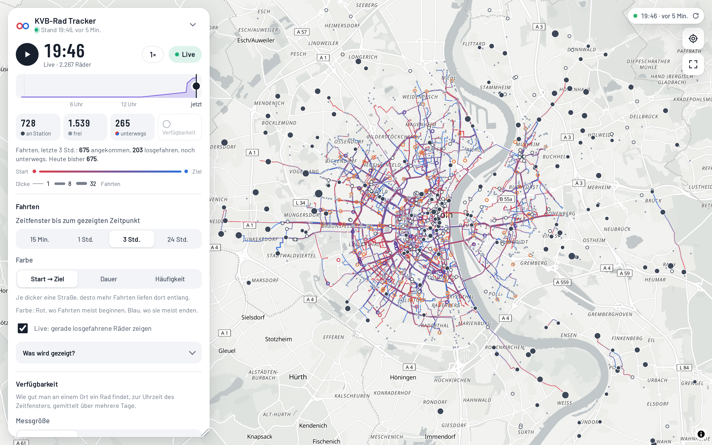
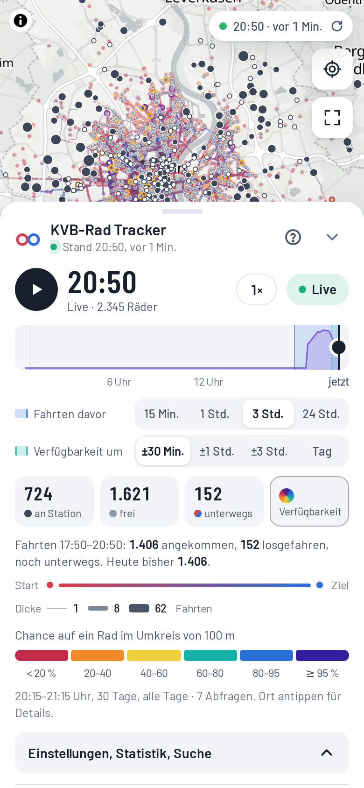
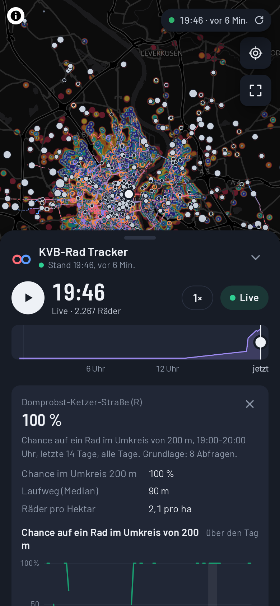

# KVB-Rad Tracker · Köln

**Live-Karte und Verlauf aller KVB-Räder in Köln.** Wo stehen gerade Räder, wo wird gefahren, und wo findet man zu welcher Uhrzeit am ehesten eins? Die Daten kommen aus der öffentlichen nextbike-API und werden jede Minute abgefragt.

*Live map and history of every KVB-Rad bike-share bike in Cologne, Germany: trips, availability and statistics from the nextbike API.*

**[→ Live-Karte öffnen](https://eneuberg.github.io/kvb-bike-tracker/)**

<a href="https://eneuberg.github.io/kvb-bike-tracker/"></a>

<p>


</p>

## Was du siehst

- **Räder live:** rund 2.300 KVB-Räder an Stationen und frei abgestellt, Stationen nach Anzahl Räder skaliert.
- **Fahrten:** jede Fahrt als geschätzte Route von Start (rot) nach Ziel (blau), alternativ nach Dauer oder nach Häufigkeit pro Straßenabschnitt.
- **Zeitleiste:** zurückspulen und abspielen, bis zu 8 Wochen Verlauf.
- **Verfügbarkeit:** Chance auf ein Rad im Umkreis, je Ort und Tageszeit.
- **Profile:** Antippen zeigt den Verlauf eines Rads oder die An- und Abfahrten einer Station.

Läuft auf Handy und Desktop, hell und dunkel.

## So funktioniert's

1. Ein Container fragt den nextbike-Feed etwa jede Minute ab und speichert Änderungen als CSV.
2. Verschwindet ein Rad und taucht woanders wieder auf, zählt das als Fahrt.
3. Der Browser berechnet die wahrscheinlichste Radroute auf dem OpenStreetMap-Netz (A\*).

## Selbst betreiben

```bash
docker compose up --build    # Karte auf Port 8080
```

Oder in Coolify als Docker-Compose-Ressource. Alternativ läuft eine einfache Version über GitHub Actions und Pages. Details zu Einstellungen, Datenformat und Methode stehen in **[docs/technik.md](docs/technik.md)**.

## Häufige Fragen

**Woher kommen die Daten?** Aus dem öffentlichen Live-Feed von nextbike, dem Betreiber von KVB-Rad (`api.nextbike.net`).

**Sind die Fahrten exakt?** Nein. Der Feed zeigt nur geparkte Räder. Start, Ziel und Zeit sind auf etwa eine Minute genau, die Route ist geschätzt.

**Ist das eine offizielle KVB-App?** Nein, ein unabhängiges Projekt ohne Verbindung zu KVB oder nextbike.

---

<sub>Kartendaten © OpenStreetMap-Mitwirkende (ODbL), Kartenstil OpenFreeMap. Radverfügbarkeit: nextbike GmbH.</sub>
